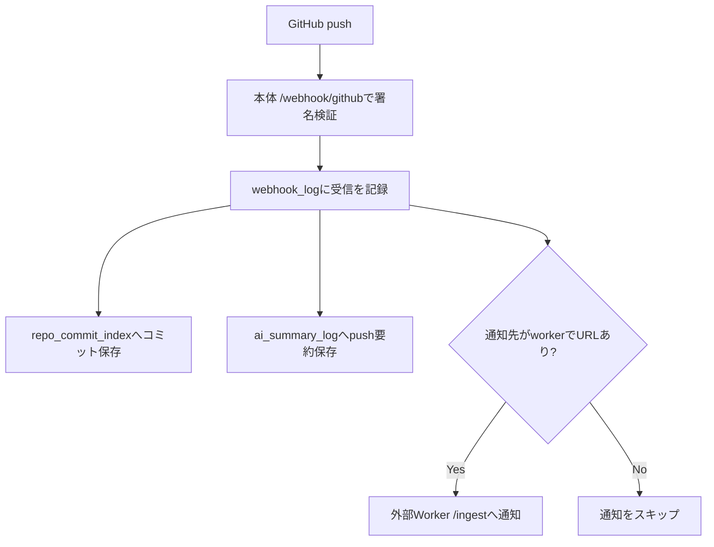

# NOTICE: GitHub webhook → Slack/外部Worker(Altワーカー) 通知パイプラインまとめ

**対象**: 本体Worker(`cloudflare-workers-github-oauth-1`)がGitHubから受け取ったwebhookイベントを、Slack、または`NOTIFY_TARGET=worker`切替時は外部Worker(`nekoserver/dynamicneko`の`cf-auth`、通称「Altワーカー」)へ通知するまでの全経路と、そこで実際に踏んだ落とし穴。今後この経路のどこかを触るときは最初に読むこと。関連スペック: [`SPEC.cloudflare-workers-github-oauth-1.AltSlackWorker.md`](SPEC.cloudflare-workers-github-oauth-1.AltSlackWorker.md)。

---

## 1. 全体像: 3種類の「webhook」が同じ語で呼ばれるので混同しやすい

この経路には見た目が似ていて紛らわしい、性質の異なる3つの通信が登場する。

| # | 経路 | 認証方式 | 通信手段 |
|---|---|---|---|
| A | GitHub → 本体Worker `/webhook/github` | `X-Hub-Signature-256`(`GITHUB_WEBHOOK_SECRET`とのHMAC) | 公開インターネット経由のGitHub公式webhook |
| B | dynamicneko/cf-auth → 本体Worker `/webhook/cf-auth`(ログイン通知) | `X-Hub-Signature-256`(`CF_AUTH_WEBHOOK_SECRET`とのHMAC、GitHub互換の自作署名) | **Service Binding**(`MAIN_WORKER`)経由、公開インターネットを通らない |
| C | 本体Worker → dynamicneko/cf-auth `/ingest`(Slack代替通知) | `Authorization: Bearer <NOTIFY_WORKER_SECRET>`(単純Bearer、HMAC署名ではない) | 公開URL(`NOTIFY_WORKER_URL`)への通常fetch |

3つとも「webhook」と呼ばれがちだが、**認証方式も通信経路も別物**。「webhookが届かない」と言われたら、まずA/B/Cのどれの話かを最初に特定すること。

### 1.1 コミット保存・要約・通知は別の処理（2026-10-08、main `47d08df3`と照合）

| 処理 | 起点 | 保存先・送信先 | 条件・注意 |
|---|---|---|---|
| コミット本文・SHAの保存 | `/webhook/github`の`push` | 本体D1 `repo_commit_index` | `repository.full_name`、DB、有効な`commits[].id/message`が必要 |
| pushのAI要約 | 同じ`push` | 本体D1 `ai_summary_log`（`event_type='push_summary'`） | ブランチ削除や要約対象メッセージなしの場合は生成しない |
| pushの通知本文 | 同じ`push` | 外部Worker `/ingest` | 解決済み通知先がworkerでURL設定済みの場合だけ送信。Slackには送らない |
| PRのAI要約・エージェント情報 | `pull_request`の`opened/synchronize` | `ai_summary_log`、`commit_agent_log`、`ai_summary_reviews` | `repo_commit_index`へのpush保存とは別 |
| PR要約の通知 | 同じPRイベント | 解決済みのSlackまたは外部Worker | main `47d08df3`ではSlack ON時のSlack送信経路が残る |

本体PRのSlack送信停止は[PR #2271](https://github.com/nekoserver/cloudflare-workers-github-oauth-1/pull/2271)で対応中（確認時点で未マージ）。未マージの修正やローカルのコードを本番の動作として扱わず、マージ・デプロイ状況を確認する。



この図はpush専用。Slackのcron更新通知、ログイン通知、PR要約通知はそれぞれ別の経路で、Slackに何か届いたことはコミット保存の成功を示さない。

## 2. 経路A: GitHub → 本体Worker `/webhook/github`

### 設定場所と受信先

コミットの自動保存には**`push`の購読**が必要。PR要約も使う場合は`pull_request`も購読する。

- リポジトリのSettings → Webhooks: Payload URLを本番Workerの`https://<本番ホスト>/webhook/github`、Content typeを`application/json`、Secretを本体の`GITHUB_WEBHOOK_SECRET`と同じ値にし、Activeを有効にする。
- GitHub App: Webhookを有効化し、同じ受信URL・Secretを設定する。対象リポジトリへのインストール、対象選択、イベント購読、必要な権限も確認する。`push`購読にはContentsのread以上が必要。
- OAuthのClient ID・Client Secretだけではwebhookの配信は設定されない。`/webhook/cf-auth`は別のSecretとアクセス判定を使うため、コミット保存用の受信先と混同しない。

受信実装は設定場所で送信元を制限せず、署名とイベントを検証する。旧[20260926 NOTICE](NOTICE.cloudflare-workers-github-oauth-1.20260926.md)の「リポジトリWebhookだけ」という断定は訂正済み。
[GitHubのwebhook種別](https://docs.github.com/en/webhooks/types-of-webhooks)、[GitHub Appのwebhook設定](https://docs.github.com/en/apps/creating-github-apps/registering-a-github-app/using-webhooks-with-github-apps)、[pushイベント](https://docs.github.com/en/webhooks/webhook-events-and-payloads#push)も参照。

```bash
gh api repos/nekoserver/cloudflare-workers-github-oauth-1/hooks \
  --jq 'map({id,active,events,url:.config.url})'
```

このコマンドは**リポジトリWebhookの一覧だけ**を見る。結果が`[]`でもGitHub App・Organizationの配信有無は判断できない。各設定元のRecent deliveriesで、本体リポジトリの`push`、送信先URL、HTTP応答、`X-GitHub-Delivery`を確認する。GitHub管理APIを読むための`gh`認証と、Workerが受信・保存するためのSecretは別。

### PAT（`ghp_*`）が必要な処理・不要な処理

| 設定 | 用途 |
|---|---|
| `GITHUB_WEBHOOK_SECRET` | 受信本文のHMAC検証。GitHub側のWebhook Secretと一致させる。PATではない |
| `DB` | 本体D1（`workers-github-oauth`）への保存。必要なマイグレーションも適用する |
| 本体Workerの`GITHUB_TOKEN` | PR/push差分・PRコミット情報をGitHub APIで取得するためのトークン |
| `NOTIFY_WORKER_URL` / `NOTIFY_WORKER_SECRET` | 外部Workerへの転送先・Bearer認証。コミット保存用の認証ではない |
| `SOT` / `SLACK_CHANNEL_ID` | Slack送信設定。コミット保存の条件ではない |

**push本文からSHA・メッセージを`repo_commit_index`へ保存する処理に`GITHUB_TOKEN`や`ghp_*`は不要。** `GITHUB_TOKEN`がない場合は差分取得をスキップするが、コミット保存は続行する。設定場所は本体WorkerのCloudflare Secretであり、GitHub ActionsのSecretとは別。トークンが必要なAPI取得では種類・権限・対象・有効期限を確認し、classic PATの接頭辞だけを必須条件にしない。

### 記録されないときの確認順序

1. 上記の配信元で、新しい`push`が正しい本番URLへ送られたか確認する。ローカルの`git commit`だけでは配信されない。設定追加後に過去履歴が自動送信されるわけでもない。
2. Secret未設定は500、署名不正は401、JSON不正は400。`ping`の200やPRイベントの200ではpush保存を確認できない。
3. 本番の`DB`バインディング・マイグレーション・参照しているD1を確認する。DB未設定でもハンドラ末尾は200を返せるため、200だけで保存成功としない。
4. `webhook_log`の`repository`・`deliveryId`で該当受信を特定する。検証成功後の`status='ok'`は受信記録で、後続の全処理成功を保証しない。保存例外は`status='error'`、`phase='repo_commit_index'`として記録される。DBやログ保存自体が失敗した場合はWorker実行ログも確認する。
5. 同じpushのSHAを`repo_commit_index`で照合する。`deleted=true`、空の`commits`、空または不正な`id/message`は追加対象にならない。同じSHAの再配信は`INSERT OR IGNORE`で追加されない。連番の競合でもIGNOREされ得るため、エラーがないことだけで全SHA保存済みと判断しない。
6. 保存済みだが画面に出ない場合は、画面の参照先が`repo_commit_index`、`ai_summary_log`、外部Workerの`alt_notify_ingest_log`、GitHub APIのどれかを確認する。別テーブルへの通知成功は代わりにならない。

本体D1での読み取り例:

```sql
SELECT event_type, status, payload, error, received_at
FROM webhook_log
WHERE source = 'github'
  AND payload LIKE '%nekoserver/cloudflare-workers-github-oauth-1%'
ORDER BY received_at DESC LIMIT 20;

SELECT commit_hash, seq_num, github_pr_number, commit_message
FROM repo_commit_index
WHERE repo_name = 'nekoserver/cloudflare-workers-github-oauth-1'
ORDER BY seq_num DESC LIMIT 20;
```

## 3. 通知送信の切り替え: `NOTIFY_TARGET`

共通通知は`src/utils/notifyDispatch.ts`の`sendNotification()`を使う。
`resolveNotifyTarget()`は`worker`だけをworkerとして扱い、それ以外はslackへ解決する。本体の`wrangler.toml`は`NOTIFY_TARGET="worker"`を明示しているが、本番の適用値も確認する。

- worker: `NOTIFY_WORKER_URL`が必要。Slack ON/OFFにかかわらず外部Workerへ送る。
- slack: `slack_enabled`がOFFで外部Worker URLがある場合は、`resolveNotifyConfigWithSetting()`でworkerへ切り替える。URLもなければSlack送信をスキップ。
- slackかつON: `SOT`と`SLACK_CHANNEL_ID`が必要。ただしpush通知はSlack宛には送らない。

通知をスキップしてもAI要約・D1保存は継続する。cron更新通知・つぶやき・セキュリティ通知などSlackへ直接送る経路もあるため、「唯一の送信窓口」「Slackへの投稿をすべて止める」と解釈しない。

## 4. 経路C: 本体Worker → Altワーカー `/ingest` — 送信ペイロードの形

`sendToWorker()`が送る本文は以下の固定形(Slack Block Kit風):

```json
{
  "channel": "SLACK_CHANNEL_ID相当の論理チャンネル名",
  "text": "本文(Markdownテーブル・箇条書きを含みうる)",
  "blocks": "Slack Block Kit形式(任意)",
  "thread_ts": "スレッド識別子(任意)",
  "source": "cloudflare-workers-github-oauth-1"
}
```

`channel`は呼び出し側が指定すればその値、未指定なら`SLACK_CHANNEL_ID`になる。pushハンドラは`repository.full_name`を指定する（11節）。

認証は`NOTIFY_WORKER_SECRET`を`Authorization: Bearer <secret>`ヘッダーに乗せるだけ。**環境変数名は送信側(`NOTIFY_WORKER_SECRET`)と受信側(dynamicneko/cf-authの`INGEST_SECRET`)で異なる**が、これは別リポジトリなので当然であり、揃えるべきは変数名ではなく**設定する値そのもの**。名前が違うことに気づかず「secretを設定したのに401になる」と混乱しないこと。

`sendToWorker()`はHTTPステータスが2xxかどうかしか見ておらず、レスポンス本文はエラー時のログ用に読むだけ。**送信側は「届いたかどうか」しか分からず、受信側が実際に何をしたか(記録できたか・表示されるか)までは関知しない。** これが次節の事故の温床になった。

## 5. 実際に起きた事故: 「200は返るが、どこにも表示されない」

dynamicneko/cf-auth側の`/ingest`実装は当初、受信データをKVに`ingest:{timestamp}:{uuid}`キーで書き込むだけで、**そのキーを読み出すコードがリポジトリ内のどこにも存在しなかった**。一方`/wspace`ページはD1の`ai_summary_log`を直接クエリして表示するだけで、KVのingestデータは一切見ていなかった。

結果、以下のような**PRのAI要約に紐付かない通知**が実質的に消滅していた:

- GitHub Appのインストール/アンインストール通知(`installation`イベント)
- cf-authのアクセス権限判定結果(経路Bとは別の、`dispatchNotification`経由の通知)

送信元(本体Worker)は200を受け取るので**エラーとして気づけない**。受信側もエラーは出ない(そもそも成功してKVに書けている)ので、**ログにも異常は残らない**。「webhookが処理されていないのに正常に見える」という、最も気づきにくい種類の不具合だった。

### 教訓

- **write-onlyなデータストアを作らない。書いたら必ずどこかで読む経路も同時に作る**、または最初から読む経路が無いなら書くこと自体をやめる。
- 送信側が2xxを受け取れても「相手が実際に使える形で記録・表示したか」までは保証されない。**受信側の処理が意味のある場所(この場合はD1・UI)まで到達しているかを、実装時に一度は目視で確認する**こと。
- Altワーカーのコード冒頭には`// Ingest endpoint (SPEC.cloudflare-workers-github-oauth-1.AltSlackWorker.md §2)`とスペックへの参照コメントがあったにもかかわらず、実装がスペック(D1の`alt_notify_ingest_log`テーブルへの記録)から逸脱していた。**スペック参照コメントがあるからといって、実装がスペック通りとは限らない**。疑わしければスペック本文と実装を突き合わせること。

### 修正内容(2026-09-10)

`/ingest`をD1の`alt_notify_ingest_log`テーブルへの書き込みに変更し、`/wspace`に`ai_summary_log`へ未リンクの生ログを表示する「その他のWebhook通知」セクションを追加した。D1書き込み失敗時は握りつぶさず500を返すようにし、送信元が異常に気づけるようにした。本体Worker側にも同じD1を参照するテーブル定義として`STATUS_TABLE_DEFINITIONS`等へ登録した(マイグレーション`0132`)。

## 6. Slack宛の別経路: `app_mention`イベントの`bot_id`判定

上記A〜Cとは別に、Slack Events APIの`/slack/event`で受ける`app_mention`イベントにも似た問題があった。当初は`event.bot_id`が付いているイベントを一律で無視しており、**他Bot経由の正当なメンションまで巻き込んで無視していた**(自分自身の発言だけを除外したいのに、条件が広すぎた)。

`SLACK_BOT_USER_ID`(自App自身のBot User ID、`U`始まり)を追加し、設定済みなら`event.user`と比較して自App自身の発言だけを除外するように変更した(未設定時は従来通りの安全側デフォルト)。確認方法: `curl -X POST https://slack.com/api/auth.test -H "Authorization: Bearer $SOT"`の`user_id`フィールド。

## 8. 同じ「見た目は成功・実は経路が途切れている」パターン: GitHub Actionsのworkflowファイル配置ミス

5節のKV write-only事故と全く同じ性質の事故が、もう1段手前の「デプロイそのもの」でも起きていた。

dynamicneko/cf-authには`main`へのpushでCloudflare Workersへ自動デプロイするGitHub Actions workflowが用意されていたが、ファイルが`cf-auth/.github/workflows/deploy.yml`という**cf-authサブディレクトリの中**に置かれていた。**GitHub Actionsはリポジトリルート直下の`.github/workflows/`しか走査しない**ため、このworkflowは一度も実行されたことがなかった可能性が高い。

つまり「PRをマージした(≒`main`へのpushというGitHubイベントは正常に発生している)のに、その先の自動デプロイという処理が誰にも実行されていない」という、5節と同型の事故だった。`git push`自体は成功するので、この種のミスは**pushする側からは何も異常に見えない**のが厄介な点。

**対処**: `.github/workflows/deploy-cf-auth.yml`としてリポジトリルートへ移動し、`working-directory: cf-auth`を指定。あわせて`paths: ["cf-auth/**"]`フィルタを付けて無関係な変更では起動しないようにし、デプロイ前に`type-check`・`test`を実行するステップも追加した(元のworkflowにはテスト実行が無かった)。

**教訓**: モノレポ的にサブディレクトリを切っているリポジトリで「〇〇の中に`.github/workflows/`を置けばそのサブプロジェクトだけデプロイされるはず」という発想は**GitHub Actionsでは通用しない**(GitLab CIの`include`のような仕組みとは違う)。workflowは常にリポジトリルートの`.github/workflows/`に置き、対象を絞りたい場合は`paths`フィルタと`working-directory`で表現すること。新しいサブプロジェクトのCI/CDを追加するときは、**まずリポジトリルートに`.github/workflows/`があるかを確認してから**workflowファイルを作ること。

## 9. Worker間の直接呼び出しで踏んだ2つの罠(`/neko hellodw` → dynamicneko)

**対象**: 本体WorkerのAIチャット`/neko hellodw`サブコマンドが、dynamicneko(Cloudflare Dynamic Worker Loaderを使ったWorker)の`GET /api/ping`を呼んで起動確認する経路。経路A/B/C(1節)とは別に、Worker同士が直接HTTPで通信するケース全般に当てはまる教訓。

### 9-1. `*.workers.dev`同士の公開`fetch()`はCloudflareに拒否される(`HTTP 404 error code: 1042`)

最初の実装は、本体Workerから`DYNAMICNEKO_URL`(dynamicnekoの`*.workers.dev` URL)へ通常の`fetch()`で呼びに行く作りだった。コード上は正しく見えたが、実際に叩くと**`HTTP 404 error code: 1042`で拒否された**。これはCloudflareの既知の制限で、**`*.workers.dev`ドメイン同士のWorkerが互いを公開`fetch()`で直接呼び合うことを許可していない**(ループ悪用防止のための仕様)。

このリポジトリには既に同じ問題を回避した実装(`dynamicneko/cf-auth/src/webhook.ts`が本体Workerを呼ぶ際の**Service Binding**経由呼び出し)が存在していたのに、それを踏襲せず新規に公開fetch方式で実装してしまったのが原因。

**教訓**: **Cloudflare Workers同士が同一アカウント内で通信する場合は、最初から公開URLへの`fetch()`ではなくService Binding(`[[services]]`)を検討すること。** 特に`*.workers.dev`ドメインを使っている場合は公開fetchが機能しない前提で設計する。既存コードに同種の通信パターン(他のWorkerを呼ぶ処理)が無いか先に探し、あれば実装方式を踏襲する。

**対処**: `wrangler.toml`に`[[services]] binding = "DYNAMICNEKO" service = "dynamicneko"`を追加し、`pingDynamicWorker()`をURL文字列ではなく`Fetcher`(Service Binding)経由の呼び出しに変更した。

### 9-2. 呼び出し元と受け側で環境変数名を揃え忘れた

Service Binding化で1042エラーは解消したが、次に`HTTP 401 Unauthorized`が発生した。原因は単純な環境変数名の食い違い: 呼び出し元(本体Worker)は`DYNAMICNEKO_PING_SECRET`という名前でsecretを設定していたが、受け側(dynamicneko)のコードは`c.env.PING_SECRET`という**別の名前**を読んでいた。ユーザーは「両方に同じ値を入れた」と認識していたが、**変数名が違うため受け側は常に未設定を見ていた**。

**教訓**: 別リポジトリ間でBearerトークン等の共有シークレットをやり取りする設計をするときは、**送信側・受信側で同じ変数名を使うか、コード内のコメント・READMEで対応関係を明示すること**。「値さえ揃えれば動く」という思い込みは、変数名の食い違いという最も気づきにくい原因を見落とす。実装時にどちらか一方だけを見て変数名を決めず、両リポジトリのコードを並べて確認してから実装すること。

**対処**: dynamicneko側のコードを、呼び出し元が実際に使っていた`DYNAMICNEKO_PING_SECRET`に合わせて修正した(値の再設定は不要、コードの変数名だけの問題だった)。

## 10. 調査の順番

「Slackやdynamicnekoに通知が来ない/見えない」と言われたら、次の順で切り分けること。

1. **どの経路の話か特定する**(1節の表)。GitHub上のイベント自体か、Slackへの投稿か、dynamicnekoの`/wspace`表示か。
2. `NOTIFY_TARGET`が意図通りの値(`slack`か`worker`)になっているか確認する。
3. 経路Cなら、本体Worker側のログ(`dispatchNotification`失敗時の`logger.error`)で送信自体が失敗していないか確認する。
4. 200が返っているのに見えない場合、**受信側が実際にデータを永続化し、かつそれを表示する経路が存在するか**を疑う(5節の事故と同じパターン)。
5. コードを直しても直らない場合、そもそも該当ブランチがマージ・デプロイされているか確認する。このリポジトリ・dynamicnekoともClaude Codeセッションから`wrangler deploy`はできないため、PRマージだけでは本番に反映されない。**さらに、マージすれば自動デプロイされる想定のリポジトリでは、そのworkflowファイルがリポジトリルートの`.github/workflows/`に正しく置かれているかも確認する**(8節)。GitHub Actionsタブで実際に該当のワークフロー実行が記録されているかを見るのが一番早い。
6. **本体Worker以外のWorkerを新たに直接呼ぶ処理を実装するときは、公開`fetch()`ではなくService Bindingを先に検討し、送受信両側の環境変数名を実装前に突き合わせる**(9節)。`HTTP 404 error code: 1042`が出たら1042専用の原因(`*.workers.dev`同士の直接fetch)を、`HTTP 401`が出たら変数名の食い違いをまず疑う。

## 11. 経路Cの`channel`欄がSlackチャンネル名固定で、Altワーカー側のリポジトリ別絞り込みに使えなかった事故

**対象**: `src/utils/notifyDispatch.ts`の`sendToWorker`(経路C送信)と、dynamicneko/cf-authの`/wspace`(リポジトリ別フィード表示)。

5節の「write-onlyなデータストア」事故とは別の、同じ根っこ(経路Cのペイロードが受信側で意味のある形になっているかを確認していなかった)から生えた問題。

### 症状

rails-rootのように、PRを経由せず直接pushされるリポジトリのコミットが、dynamicneko/cf-authの`/wspace`でリポジトリ別に絞り込んで表示できなかった(そもそもチャンネル一覧にも出てこない)。

### 原因

1. `sendToWorker()`が送るJSONの`channel`欄は、常に`config.slackChannel`(=`SLACK_CHANNEL_ID`、Slack用のチャンネルID)を入れていた。`NOTIFY_TARGET=worker`運用ではSlackへは送らないため、この値は本来無意味だが、そのままAltワーカー側の`alt_notify_ingest_log.channel`へ保存されていた。
2. push通知はリポジトリ名(例: `nekoserver/rails-root`)を`channel`として送ってほしい箇所だったが、`dispatchNotification`の呼び出し側(`/webhook/github`のpushハンドラ)はそれを渡す手段(`NotifyMessage`にそのようなフィールド)が存在しなかった。
3. dynamicneko/cf-auth側の`/wspace`は、`?repo=`でリポジトリ絞り込み中は`alt_notify_ingest_log`を常に空配列として扱っており(5節の修正で「未リンクのingestログ」自体は表示できるようになっていたが、リポジトリ別絞り込みには対応していなかった)、チャンネル一覧(`getChannels`)も`ai_summary_log`(PRサマリー)しか見ていなかった。PRサマリーを一度も生成していないリポジトリは、どう絞り込んでもpushコミットの通知が見える経路が無かった。

### 修正(2026-10-04)

- `NotifyMessage`に`channel?: string`を追加し、`target='worker'`のときだけ`message.channel ?? config.slackChannel`を使うようにした(`target='slack'`では従来通り`config.slackChannel`固定)。
- pushハンドラは`dispatchNotification(pushNotifyConfig, { text, channel: repositoryFullName })`とし、リポジトリ名を渡すようにした。
- dynamicneko/cf-auth側は、`getChannels`を`ai_summary_log`と`alt_notify_ingest_log.channel`のUNIONに変更し、PRサマリーが無いリポジトリもチャンネル一覧に出るようにした。また`getUnlinkedIngestLogByChannel(db, channel, limit)`を追加し、リポジトリ絞り込み中でも`channel`が一致するingestログ行を表示するようにした。

### 教訓

- 経路Cの固定ペイロード(4節)は「送信側が決め打ちで埋める値」と「呼び出し元ごとに変えたい値」が混在していた。**固定ペイロードに見えても、呼び出し元の種類によって意味が変わるフィールド(ここでは`channel`)がないか疑うこと。**
- 受信側の絞り込みUI(ここではリポジトリ別フィード)を実装・変更するときは、**そのUIが参照するテーブルに、絞り込みキー(ここではリポジトリ名)が実際に入る経路があるかを送信側のコードまで遡って確認する**こと。UI側だけ見て「表示条件を直せば直る」と判断すると、そもそもデータが来ていないケースを見逃す。
