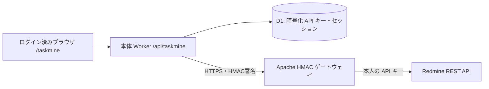

# SecureMine 仕様

確認日: 2026-10-09（JST）。対象は `cloudflare-workers-github-oauth-1` の SecureMine。`origin/main` の `06f89f36` を基準に実装を確認した。本書は現行実装の仕様を記録し、本番での動作確認結果とは区別する。

## 目的と入口

SecureMine は、本体 Worker にログインしたユーザーが Redmine の課題を閲覧・検索・作成・更新する日本語のブラウザ画面。表示名称は SecureMine だが、URL と既存の関数・ファイル名には TaskMine の名称を維持している。

- ページ URL: `/taskmine`。
- ページと専用 API は本体の `authMiddleware` を通す。
- Redmine の権限は本人の API キーと Redmine 側のワークフローに従う。本体へのログインだけで Redmine の操作権限を付与しない。
- 実 Redmine への接続と、ページ内のサンプルデータを使う操作デモを提供する。

## 画面と操作

| 領域 | 挙動 |
| --- | --- |
| ヘッダー | SecureMine の名称、アカウント切り替え、明暗テーマ切り替え。接続後はブランドを `🔐SecureMine` と表示 |
| 課題一覧 | 「すべての課題」「自分の担当課題」を切り替え、プロジェクト・ステータス・優先度・期限・キーワードで絞り込む |
| 課題詳細 | 本文、属性、進捗、添付、変更履歴を表示。本文・プレビューは Markdown として扱う |
| 課題フォーム | 作成・編集、コメント、添付アップロード。保存後に一覧と対象課題を再取得 |
| プロジェクト | プロジェクトの切り替えと一覧・概要の表示 |
| コミットログ | 本体の現在のワークスペースに属する GitHub コミットの当月カレンダー |
| 接続設定 | アカウント名、HTTPS の Redmine URL、本人の API キーを入力 |
| 同期表示 | 未接続・同期中・同期済み・同期失敗を表示し、取得時刻を示す |

右端の「課題」「プロジェクト」「コミット」ボタンは各セクションを独立して開閉する。課題ボタンは一覧と詳細をまとめて開閉する。ボタンは上下にドラッグでき、上下矢印キー・Home・End キーでも移動できる。開閉状態を `aria-expanded` で示し、ドラッグ後のクリックによる誤開閉を抑える。

スマートフォン向けにレイアウトを切り替える。テーマは共通テーマ実装を使用し、切り替え時に `user_theme` Cookie を保存する。

## 課題の取得・保存・同期

実課題は `issues.json` から50件ずつ、`updated_on:desc` で取得する。未指定のステータスは `status_id=*`。プロジェクト、ステータス、優先度、自分の担当（`assigned_to_id=me`）は Redmine 側で絞り込む。キーワードと期限は取得済みのページ内で絞り込むため、全課題を横断した検索結果ではない。

保存項目は `project_id`、`tracker_id`、`subject`、`status_id`、`priority_id`、`assigned_to_id`、`due_date`、`description`、`done_ratio`、`notes`。題名は必須。添付を `uploads.json` に送って得た token を課題の `uploads` に付け、作成は POST、更新は PUT で送信する。

手動同期ボタンと、チェックボックスで有効化する60秒間隔の自動同期を提供する。非表示のタブでは自動同期を実行せず、同期・操作中の重複同期を避ける。アカウント変更などで不要になった応答は世代番号で識別して画面への反映を抑える。同期失敗時は、前回取得したデータがあればその表示を維持して失敗状態を示す。

操作デモの課題作成・編集・履歴・添付情報はページ内のデータに反映し、再読み込みでリセットする。デモでの保存は実 Redmine に送信しない。

## 接続とログイン復元

ブラウザで URL が HTTPS であることを確認し、URL 内の認証情報・クエリ・フラグメントを拒否する。末尾スラッシュを除いて接続先を扱う。アカウント名は最大80文字、API キーはサーバー側で空値と512文字超を拒否する。

接続時にユーザー・プロジェクト・ステータス・優先度・トラッカーを取得し、`POST /api/taskmine/login` でも `users/current.json` により本人のキーを検証する。保存する Redmine の本人情報は id・login・firstname・lastname に絞り、Redmine 応答に含まれ得る API キーなどを除く。処理中はスピナーを表示し、成功時に入力欄のキーを消去して「ログイン完了」を5秒間表示する。

現行実装は API キーを Worker で暗号化し D1 に保存する。暗号方式は AES-GCM、IV はランダムな12バイト。鍵は用途を区別する文字列と `JWT_SECRET` の SHA-256 から導出し、所有ユーザー ID と Redmine URL を追加認証データに含める。`JWT_SECRET` を変更すると既存の暗号化キーを復号できなくなるため、再ログインが必要になる。

セッション token は UUID を2つ連結して生成し、DB には SHA-256 ハッシュだけを保存する。Cookie は以下の設定。

| 項目 | 値 |
| --- | --- |
| Cookie 名 | `securemine_session` |
| Path | `/api/taskmine` |
| 属性 | `HttpOnly; Secure; SameSite=Lax` |
| Max-Age / セッション有効期間 | `604800` 秒（7日） |

ログイン時に本体セッションも `1w` に更新し、`user_sessions` のログイン・活動時刻を更新する。本体の認証・アイドル期限と SecureMine の期限は別の判定であり、7日間の無条件な利用を保証するものではない。

再読み込み時は `GET /api/taskmine/session` で本体ユーザーに属する未失効のセッションを取得し、メタデータを再取得して接続を復元する。復元応答に API キーは含めない。以後のプロキシは Cookie のセッションと一致する接続先についてキーを復号できる。

同一ページでは複数のアカウントを追加して切り替えられる。新規追加したアカウントのキーはそのページのメモリにも保持される。Cookie は最後にログインしたセッションを指すため、再読み込みで全アカウントが復元される設計ではない。確認した専用 API にログアウト・セッション削除 API はなく、期限切れの保存セッションは次回ログイン時に削除する。

## 通信構成



ブラウザは同一オリジンの Worker に通信し、Worker が登録済みのゲートウェイへ署名付きで転送する。ブラウザから Redmine へ直接 fetch する構成ではない。ページの CSP は `connect-src 'self'`、`frame-ancestors 'none'`、`form-action 'self'` などを設定し、ページ・専用 API の応答は `Cache-Control: no-store` とする。スクリプトとスタイルには現行 HTML のインライン実装を許可している。

| メソッド・パス | 役割 |
| --- | --- |
| GET `/taskmine` | SecureMine の HTML |
| POST `/api/taskmine/login` | キーの確認、暗号化保存、Cookie 発行、本体セッション更新 |
| GET `/api/taskmine/session` | 本人の保存済み接続・ログイン時刻・失効時刻を返す。未接続なら `account: null` |
| `/api/taskmine/redmine?base=…&path=…` | Redmine API の許可された操作を署名・転送 |
| GET `/api/taskmine/commit-calendar` | 現在のワークスペースの当月コミット日を返す |

プロキシは明示的な `X-Redmine-API-Key` があればそれを使い、なければ本人の保存セッションから復号する。`base` が保存セッションの URL と一致することを確認する。接続先は `REDMINE_HMAC_TARGETS` のキーと一致した場合だけ利用でき、ゲートウェイ URL は HTTPS で認証情報・クエリ・フラグメントを含めない。

更新操作には同一オリジンの Origin ヘッダーを要求する。GET でも Origin があれば同一オリジンであることを確認する。パスの改行・バックスラッシュ・フラグメント・不正なエンコード・ディレクトリ逸脱を拒否する。

| Redmine メソッド | 許可する相対パス |
| --- | --- |
| GET | `users/current.json`、`projects.json`、`issue_statuses.json`、`enumerations/issue_priorities.json`、`trackers.json`、`issues.json` |
| GET | `projects/{id}/memberships.json`、`issues/{id}.json`、`attachments/download/{id}`（任意のファイル名を含む形式にも対応） |
| POST | `issues.json`、`uploads.json` |
| PUT | `issues/{id}.json` |

ID は正の整数。DELETE など、上表以外の操作は拒否する。送信 Content-Type は JSON または octet-stream、GET は空として署名する。リクエスト本文は10MiBまで、Worker の接続タイムアウトは30秒。ゲートウェイは内部接続25秒・応答を含む10MiB制限を持つ。リダイレクトは追跡せず、Worker はゲートウェイの3xxを502として扱う。

## HMAC ゲートウェイ

Worker は `X-Redmine-API-Key`、`X-Redmine-Timestamp`、`X-Redmine-Nonce`、`X-Redmine-Signature` を送る。署名は HMAC-SHA256 の小文字 hex。次の8項目を LF で連結し、末尾 LF を付けない UTF-8 バイト列を署名する。

```text
redmine-v1
HTTPメソッド
Redmine相対パス（クエリ込み）
UNIX秒
nonce
APIキーのSHA-256 hex
Content-TypeのSHA-256 hex
本文のSHA-256 hex
```

ゲートウェイは署名と許可パスを検証し、60秒を超える時刻差と nonce の再利用を拒否する。nonce は SQLite で共有し、署名時刻+120秒まで保持する。CGI 入口から共通 WSGI ファイルの処理を利用する構成を提供する。内部 Redmine が自己署名 TLS の場合は `upstream_ca` に信頼する証明書を指定する。

## 保存データとコミットカレンダー

マイグレーション `migrations/0168_create_securemine_sessions.sql` は以下を作成する。

| テーブル | 主なデータ |
| --- | --- |
| `securemine_sessions` | token hash、所有ユーザー ID、Redmine URL、アカウント名、暗号化 API キー、限定した本人情報 JSON、ログイン時刻、失効時刻 |
| `securemine_login_history` | 連番 ID、本体ユーザー ID、Redmine URL、Redmine ユーザー ID、ログイン時刻 |

コミットカレンダーは Redmine の履歴ではなく、本体の GitHub コミットキャッシュを使用する。現在のユーザーのワークスペースを解決し、`commit_list_cache` の正の `commit_count` がある日と `commit_calendar_cache.counts` の正の件数がある日を統合する。日付は JST の当月に限定し、重複を除いて昇順で返す。応答は `{year, month, days}`。既存キャッシュを読む API であり、ここで GitHub から新規取得する処理はない。

## 設定と運用

必要な Worker バインディングは `DB`、`JWT_SECRET`、`REDMINE_HMAC_SECRET`、`REDMINE_HMAC_TARGETS`。D1 に上記マイグレーションと既存の本体・コミットキャッシュのスキーマを適用する。Redmine の REST API を有効化し、ゲートウェイと Worker に同じ HMAC シークレットを設定する。

接続先マップの構造例（秘密値を含まない）:

```json
{"https://redmine.example.com":"https://redmine.example.com/redmine-hmac"}
```

ゲートウェイの配置と設定例は `deploy/redmine/README.md`、`gateway.cgi`、`gateway.wsgi`、`config.json.example`、`apache-cgi.conf.example` にある。VM の Ruby・Rails・関連 gem の導入状況は `SPEC.cloudflare-workers-github-oauth-1.Cursor-VM-Ruby.md` を参照する。

| エラー | 主な確認箇所 |
| --- | --- |
| 400 | 接続入力、API キー、許可 API、Content-Type |
| 403 | Origin、接続先マップ、ゲートウェイ署名・時刻・nonce、Redmine の権限 |
| 413 | リクエスト本文のサイズ |
| 502 | ゲートウェイ到達、リダイレクト、内部 TLS、Redmine 応答、コミットキャッシュ取得 |
| 503 | Worker バインディング、DB・スキーマ、暗号化キーの復元、ワークスペース |

HTTP ステータスだけで原因を断定せず、応答のメッセージと失敗した経路を確認する。秘密値や API キーを診断ログ・SPEC に記録しない。

## 確認範囲と関連実装

この SPEC の作成では、最新 main の実装・マイグレーション・配置資料を参照した。実 Redmine への作成・更新・添付、7日後の失効、本番の暗号化保存、VM 再起動後の復元を新たに検証したものではない。

主な実装は `src/views/taskmine.ts`、`src/utils/redmineProxy.ts`、`securemineLogin.ts`、`securemineSessionStore.ts`、`securemineCalendar.ts`、`securemineCommitDays.ts`、`securemineSectionTabs.ts` と `src/index.ts`。関連テストは `taskmine.test.ts`、`redmineProxy.test.ts`、`securemineLogin.test.ts`、`securemineCalendar.test.ts`、`securemineCommitDays.test.ts`、`securemineSectionTabs.test.ts`、`deploy/redmine/test_gateway.py`。

過去の資料にある「API キーはページ内メモリのみ」「ブラウザから Redmine へ直接通信するため CORS 設定が必要」という説明は、現行の暗号化保存・Worker 経由接続とは異なる。現行仕様の判断には本書と対応する実装を参照する。
