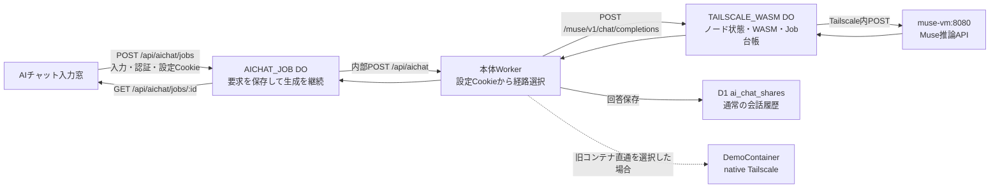

# SPEC.cloudflare-workers-github-oauth-1.aichat-muse.20261106.md

## /aichatでのmuse_promptの扱い

**対象**: `/neko askgk muse_prompt="◯"` — `/aichat`での質問の表示・回答の保存・エンジン情報の表示を、Codex・Claudeと揃える。

関連: lib側の修正 [nekoserver/lib#111](https://github.com/nekoserver/lib/pull/111)、コンテナ側の設定 `lib/SETTINGS.claude-host.20261102.md`の「muse_prompt」。

---

## 背景

`muse_prompt`の送信経路は#2524で追加されたが、`/aichat`側の処理はCodex・Claudeと揃っていなかった。2026-11-06に次の症状を確認した。

| 症状 | 原因 |
|---|---|
| 質問の吹き出しに`/neko askgk muse_prompt="◯"`がそのまま出る | `formatAskgkPromptQuestion`の正規表現が`codex`・`claude`だけを対象にしていた |
| 回答が`neko/askgk`として保存される | `askgkModel`が`codex`・`claude`だけで、Museは`autoSave`の経路へ入っていた |
| `Engine:`・`Model:`の行が出ない | libのworkerが`llm_model`だけを保存し、`tunnels_lib.rb`が読む`model`が無かった |

libはメッセージの`muse_prompt=`を正しく除去しており、Museへ接頭語は渡っていない。接頭語が残っていたのは本体Workerの表示と保存である。

---

## 経路

```
/aichat の入力
  → 本体Worker（接頭語ごとaskTunnelSignerへ渡す）
  → rust-worker-sqlx-d1 /tunnel-signer
  → https://mygw.nekomaneki.work/lib/api/tunnels
  → LLM worker → tailscale nc → muse-vm:8080 /v1/chat/completions
```

Museへの送信はCodex・Claudeと違いCLIを実行せず、sandboxの外でHTTPを送る。

---

## 仕様

| 項目 | 動作 |
|---|---|
| Workerからlibへ送る文字列 | `muse_prompt="◯"`のまま。接頭語を除去しない |
| 吹き出し・共有・`ai_chat_shares.question` | 引用符の内側の本文`◯`だけ。`"`と`“ ”`のどちらでもよい |
| 閉じていない入力 | 変換せず、入力のまま扱う |
| `ai_chat_shares.model` | `muse` |
| 応答の`usedModel` | `muse` |
| スレッド | Claudeと同じ。所有を確認できないスレッドIDは再利用せず、新しいスレッドへ保存する |
| 回答末尾の情報行 | `Engine: Muse / Model: muse` |
| 色丸のモデル一覧 | `muse`を`commandOnly`で追加する。色は`assignModelColors`で割り当てる |
| 色丸で`muse`を選んだ通常の質問 | `/neko askgk muse_prompt="…"`に変換して送る |
| 色丸とプレフィックスの関係 | 互いに影響しない。プレフィックス付きの質問は、色丸で選択中のモデルの影響を受けない（[AGENTS.md](AGENTS.md#aiチャットの言語モデルスイッチとプレフィックス)） |
| 回答の表示 | Claude・Codexと同じく、リンクの脚注化とコードの色付けを行う |
| 質問ツリー（`/api/mcp-sample/codex-questions`） | `model`に`muse`を含める。表示名は`Muse` |

### Effort

MuseのAPIの応答にeffortの項目は無い。返るのは`id`・`object`・`created`・`model`・`choices`・`usage`で、`choices[0]`は`index`・`message`・`finish_reason`。そのため`Effort:`は表示しない。値を推定して補わない。

`Model:`はAPIの`model`の値で、2026-11-06時点では`muse`のみ。

---

## 対象外

- `/aichat`のCodex・Claude比較（`src/views/aichatCrossModel.ts`、`src/index.ts`の`model IN ('claude', 'codex')`）。2エンジンの比較のまま変えない。
- `nemotron`。libの`route`は受け付けるが、`run`が`unsupported_engine`を返す。
- 変更前に`neko/askgk`として保存したMuseの回答の移行。
- Museの応答の`usage`の利用。トークン数はCodex・Claudeと同じく文字数から推定する。

---

## 修正内容

| ファイル | 変更 |
|---|---|
| `src/utils/codexAskgkQuestion.ts` | 質問本文の抽出の対象に`muse`を追加 |
| `src/utils/aichatSlashCommand.ts` | `muse_prompt="…"`で`museAskgk`を返す |
| `src/index.ts` | `askgkModel`に`muse`を追加。色の割り当てと色丸からの送信にも追加 |
| `src/utils/aichatModelConfig.ts` | `MUSE_ASKGK_MODEL`を追加 |
| `src/views/aichat.ts` | モデル一覧・色・回答の表示に`muse`を追加 |
| `src/routes/codexQuestionTree.ts`、`src/views/codexQuestionTree.ts` | 質問ツリーの対象に`muse`を追加 |

---

## テスト

| 対象 | テスト |
|---|---|
| 質問本文の抽出 | `src/utils/codexAskgkQuestion.test.ts` |
| 吹き出し・共有・モデル一覧 | `src/aichat-codex-question-display.test.ts` |
| 接頭語を保ったまま送り、`museAskgk`を返す | `src/utils/aichatSlashCommand.test.ts` |
| `ai_chat_shares`への保存 | `src/aichat-askgk-save-integration.test.ts` |
| 質問ツリー | `src/routes/codexQuestionTree.test.ts` |
| workerの`model`（lib） | `claude/test/llm_worker_muse_test.py` |

---

## 関連コミット

- lib: [`4d10939`](https://github.com/nekoserver/lib/commit/4d10939) fix: muse_promptのモデル名をtunnelsの応答へ渡す

---

## 反映

lib側はworkerの再起動で反映する。本体Worker側はデプロイが必要。

---

## 注意事項

**対象**: 2026-11-06時点の未確認の項目 — 修正後に実環境で確かめる。


- 本体Workerの修正を反映した実画面での表示と保存。
- Slackからの`/neko askgk muse_prompt="◯"`の動作。

---

## 2026-11-08: Worker→Muse POSTを既定経路にする

### 経路と保存の境界



ブラウザの入力窓はモデルがMuse・Codex・Claudeのどれでも`POST /api/aichat/jobs`へ送る。AICHAT_JOB DOが内容と認証Cookieを保持し、非同期に同じWorkerの`POST /api/aichat`へ渡す。タブ切替・再読み込み時はlocalStorage上のJob IDから進捗を取り直すため、通常入力窓のエージェント問い合わせもブラウザ接続切断後に継続する。Workerは設定された経路でMuseへ一度だけ要求する。回答は通常のAIチャット履歴へ1件保存し、transport名やテストマーカーを質問本文へ足さない。Worker経路と旧コンテナ経路はユーザーの保存済み設定で選び、失敗時に相互fallback・再送しない。

`/tailscale-wasm`の補助エージェント欄はtunnels.rbへ直接問い合わせるためAICHAT_JOBを使わず、同画面を閉じた後の進捗回収はしない。この補助問い合わせにもタブ切替を越えたジョブ再開を提供する場合は、別途AICHAT_JOB経由へ接続する変更が必要。

### GET/POSTの区別

| 用途 | HTTP | 接続先 | 推論するか |
|---|---|---|---|
| Museのhealth/状態確認 | GET | `GET /muse/health` → `GET http://muse-vm:8080/health` | しない。到達・稼働状態だけ |
| Workerを本線とする質問 | POST | `POST /api/aichat/jobs` → `POST /api/aichat` → TAILSCALE_WASM DO → `POST /v1/chat/completions` | する。Workerの既定経路 |
| 旧コンテナ直通を選んだ質問 | POST | `POST /api/aichat` → DemoContainer → `POST /muse/v1/chat/completions` → `POST /v1/chat/completions` | する。明示選択時の互換経路 |

したがってGET専用なのは参照用health endpointであり、旧コンテナ直通の質問生成は現在もPOSTである。「旧MuseはGET専用」という表現を旧コンテナの推論経路の意味で使うと実装と矛盾するため、ここではGET=status/health、POST=inferenceとして区別する。Muse推論APIへのGET送信は行わない。

### Durable Objectの役割と必要性

`TAILSCALE_WASM`は入力履歴のキャッシュではない。Cloudflare Workerの通常リクエスト実行は要求ごとに終わる一方、サーバー側Tailscaleノードには秘密のノード状態を再利用できる安定した保存場所と、要求を処理するWorker isolateが必要となる。専用DOはSQLite内の非公開Tailscale状態を保持し、同じ`muse`ノードとして再接続し、WASMから固定のMuse宛先へ送信する実行主体である。これを外したままWorker内Tailscale接続を保つことはできず、ブラウザ内WASMか別の常時接続ノード（例: コンテナ）へ役割を移す設計変更が必要になる。

別用途で、同DOのSQLiteにMuseのAgent Job/返信台帳を持つ。これらはAIチャット履歴ではなく、Job受付・重複排除・配送結果の記録である。送信中に処理が途切れた状態は`delivery_unknown`とし、自動再送しない。

`AICHAT_JOB`は異なるDOで、AIチャットの入力送信をブラウザ接続から分離し、タブを閉じても生成・履歴保存を続ける。通常の会話履歴はD1の`ai_chat_shares`が保持する。同期送信に作り替えればAICHAT_JOBを外せるが、ブラウザ切断後の完了・結果回収は失われる。AICHAT_JOBはTailscaleネットワーク接続の代替ではない。

### 接続先ページの補助機能

`/tailscale-wasm`はWorker→Muse POST、永続Job/返信、全コンテナ状況、Worker/DO利用量とコンテナ台帳の費用概算を提供する。Codex/Claudeのtunnels問い合わせとT3テスト/ログイン引き継ぎは補助経路で、本体コンテナが稼働中の場合だけ有効。T3の一回限りpairing link生成は`src/utils/t3PairingHandoff.ts`の共通関数を`/cf-containers`と本ページから呼ぶ。料金部品は`src/views/tailscaleWasmCost.ts`でWorker/DOとcontainer widgetsを独立したHTML/JS関数として構成する。

### 検証と現在の状態

- 実Durable Object→Tailscale WASM→`muse-vm:8080/v1/chat/completions`のPOSTはHTTP200、指定回答完全一致。logout後に503で停止も確認: [結果](artifacts/wasm-tailscale-20261108/worker-do-live.jsonl)。
- 入力窓と同じ`source: textbox`ペイロードをAICHAT_JOB APIへ実POSTしたところ、Jobは202で作成され完了したが、全Worker bundleでWASMの`syscall/js os.Getpid` panicが発生し、Muse到達不可・マーカー応答なし。実DO直通成功とは区別する。再送はしていない: [診断結果](artifacts/wasm-tailscale-20261108/aichat-live-e2e-result.jsonl)。よってAIチャット入力窓のMuse実回答は未確認。
- 関連テスト: `src/aichat-muse-transport.test.ts`、`src/aichat-askmuse-integration.test.ts`、`src/utils/museAgentJobs.test.ts`、`src/utils/t3PairingHandoff.test.ts`、`src/utils/tailscalePageTools.test.ts`、`src/views/tailscaleWasmCost.test.ts`ほか。ページ生成JavaScript・実Chromeのtailscale-wasm UI検査は成功。Chrome APIは模擬。
- Cloudflare productionのWorker公開・DO migrationは未実施。本番ログイン済みAIチャットからの実投稿は確認していない。

---

## Muse選択の接頭語なし投稿は、tunnelsへ切り替えず直接muse-vmへ送る（2026-11-07）

**対象**: `src/index.ts`の`POST /api/aichat`、`src/views/aichatMuseHealth.ts`のMuseの⚙モーダル — 言語モデルスイッチがMuseのときの、プレフィックスの無い投稿の経路。

### 背景

[#2533](https://github.com/nekoserver/cloudflare-workers-github-oauth-1/pull/2533)で、Tailscaleを確かめられないときに設定がONなら`/neko askgk muse_prompt="…"`（tunnels経由）へ変換して送るフォールバックを入れた。ユーザー指定（2026-11-07）により、スイッチがMuseのときの接頭語なし投稿は、tunnels方向ではなく直接muse-vmへ送る。AGENTS.md「AIチャットの言語モデルスイッチとプレフィックス」の「2つの経路を互いの代替として扱わない」にも合わせる。

### 修正内容

| ファイル | 変更 |
|---|---|
| `src/index.ts` | Tailscaleを確かめられないときは、設定やCookieに関係なく止める（tunnelsへ変換しない）。`museTunnelsFallback`と`fallbackUsed`を削除 |
| `src/views/aichatMuseHealth.ts` | 「Tailscale未接続時に tunnels を使う」の設定と`aichat_muse_tunnels`のCookieの読み書きを削除 |
| `src/aichat-askmuse-integration.test.ts`・`src/views/aichatMuseHealth.test.ts` | 指定やCookieがONでもtunnelsへ送らないこと、設定を表示しないことを確かめる |

明示の`/neko askgk muse_prompt="…"`（tunnels経由）と`/askmuse prompt="…"`（直接）は変えていない。ブラウザに残った`aichat_muse_tunnels`のCookieは読まなくなるだけで、消してはいない。
