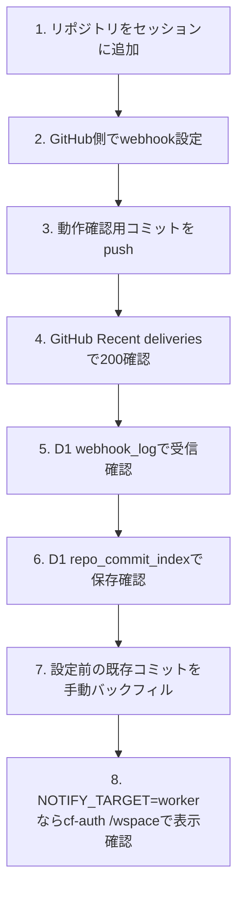

# SPEC.cloudflare-workers-github-oauth-1.new-repo-onboarding.md

## 新リポジトリをGitHub webhook通知パイプラインに乗せる手順

**対象**: 新規リポジトリ(`nekoserver/<repo>`)を、本体Worker(`cloudflare-workers-github-oauth-1`)の`/webhook/github`受信 → `repo_commit_index`/`ai_summary_log`保存 → (NOTIFY_TARGET=worker時)外部Worker`/ingest` → cf-auth `/wspace`表示、という既存の通知パイプラインに新規に乗せるための一連の手順。2026-10-12、`nekoserver/railway`をオンボーディングした際に確立した。NOTICE([`NOTICE.cloudflare-workers-github-oauth-1.github-webhook-slack.md`](NOTICE.cloudflare-workers-github-oauth-1.github-webhook-slack.md))に書かれている「経路A/B/C」の区別、特に経路A(GitHub→本体Worker)を初めて設定する側の手順として位置づける。

---

## 背景

既存のNOTICEは「経路が壊れたときにどう調査するか」を主に記録しているが、「新しいリポジトリを初めてこのパイプラインに追加するとき、何を・どの順で・どう確認すればよいか」という立ち上げ手順そのものはどこにも明文化されていなかった。`nekoserver/railway`のオンボーディングでは、webhookの配信自体は200を返していたにもかかわらず、以前からあったコミット(webhook設定前のpush)は自動では取り込まれない、という「200は返るが特定のコミットだけ記録されない」という紛らわしい状態に遭遇した。この経験を手順として固定する。

---

## 全体フロー



---

## 手順

### Step 1: リポジトリをセッションに追加する

`add_repo`で対象リポジトリ(`nekoserver/<repo>`)を追加し、`--depth 1`の浅いcloneを行う。cloneが成功したら`register_repo_root`を呼び、そのリポジトリのCLAUDE.md等を読み込む。

このステップは「このセッションから対象リポジトリのコードや履歴を読む」ためのものであり、webhook配信そのものには影響しない。CLAUDE.mdが無いリポジトリ(今回の`cf-auth`のように)も存在する。

### Step 2: GitHub側でwebhookを設定する

対象リポジトリのSettings → Webhooksで以下を設定する。

| 項目 | 値 |
|---|---|
| Payload URL | 本番Workerの`https://<本番ホスト>/webhook/github` |
| Content type | `application/json` |
| Secret | 本体Workerの`GITHUB_WEBHOOK_SECRET`と同じ値 |
| Active | 有効 |
| 購読イベント | `push`(コミット保存に必須)。PR要約も使うなら`pull_request`も追加 |

GitHub Appでインストール範囲を「選択したリポジトリ」にしている場合は、対象リポジトリをインストール対象に追加する(`installation_repositories`イベントで`installation_permissions`テーブルが自動更新される)。

**注意**: OAuthのClient ID・Secretだけではwebhook配信は設定されない。リポジトリWebhookとGitHub Appは別物であり、どちらで配信しているかを把握しておく。

### Step 3: 動作確認用コミットをpushする

設定直後にGitHubから過去のpush履歴が自動送信されることはない。必ず新規のコミットを1件pushして、webhookを実際に発火させる。

```bash
cd <CLONE_DIR>
# 何らかの軽微な変更
git add <file>
git commit -m "<動作確認用の日本語コミットメッセージ>"
git push origin main
```

### Step 4: GitHub側でRecent deliveriesを確認する

対象リポジトリのSettings → Webhooks → Recent deliveriesで、今回の`push`配信のHTTPステータスを確認する。

| ステータス | 意味 |
|---|---|
| 200 | 署名検証を通過し、受信処理まで完了(保存成功は別途確認が必要。下記参照) |
| 401 | 署名不正。Secretの不一致を疑う |
| 500 | `GITHUB_WEBHOOK_SECRET`未設定、またはDB関連の例外 |

**200は「保存成功」の証明にはならない。** `ping`イベントの200、または`push`以外のイベントの200を「コミット保存成功」と誤認しないこと。イベント名(`push`かどうか)を必ず確認する。

### Step 5: D1の`webhook_log`で受信を確認する

```sql
SELECT event_type, status, received_at FROM webhook_log WHERE source = 'github' AND payload LIKE '%<owner>/<repo>%' ORDER BY received_at DESC LIMIT 20;
```

リポジトリ名で絞って0件の場合、署名検証で拒否された配信(`status='rejected'`)はpayloadにリポジトリ情報を含まないため、このクエリでは見えない。その場合はリポジトリ名で絞らない全件クエリで確認する。

```sql
SELECT event_type, status, error, received_at FROM webhook_log WHERE source = 'github' ORDER BY received_at DESC LIMIT 20;
```

### Step 6: D1の`repo_commit_index`で保存を確認する

```sql
SELECT commit_hash, seq_num, commit_message FROM repo_commit_index WHERE repo_name = '<owner>/<repo>' ORDER BY seq_num DESC LIMIT 20;
```

Step 3でpushしたコミットのフルハッシュ(40桁)が`commit_hash`に出ていれば、経路A(GitHub→本体Worker→D1保存)は正常に機能している。

### Step 7: webhook設定前の既存コミットを手動バックフィルする

**ここが最も見落としやすい。** webhookは設定後に発生したイベントしか配信しない。Step 2より前に存在していたコミットは、Step 6の自動保存の対象にならず、`repo_commit_index`に永久に欠番として残る。

対象リポジトリの既存コミット全履歴を、[`SPEC.cloudflare-workers-github-oauth-1.COMMITDB.md`](SPEC.cloudflare-workers-github-oauth-1.COMMITDB.md)の手順に従って手動で`INSERT OR IGNORE`する。

```bash
cd <CLONE_DIR>
git fetch origin main
git log origin/main --reverse --format="%H|||%s"
```

既にStep 6でseq_num=1として自動保存されたコミットがある場合、バックフィル対象の既存コミットはそれより前のseq_num(0, -1, ...)として追加するか、既存の自動保存分を含めて全件seq_numを振り直す必要がある。`nekoserver/railway`のケースでは、設定前の1件(`9a16be0`)をseq_num=0として追加し、設定後の自動保存分(`6eb4e08`)のseq_num=1はそのまま残した。

このSPECをオンボーディング手順として使う場合、**Step 3(動作確認コミット)を打つ前にバックフィルを先に済ませておけば、seq_numの欠番やずれを避けられる**。順序を入れ替える場合はStep 3とStep 7を逆にしてよい。

### Step 8: cf-auth `/wspace`での表示を確認する(NOTIFY_TARGET=workerの場合のみ)

本体Workerの`NOTIFY_TARGET`が`worker`の場合、pushは外部Worker(`nekoserver/cf-auth`)の`/ingest`へ転送され、`alt_notify_ingest_log`テーブルに記録される。cf-authの`/wspace`ページ(`src/index.ts`の`app.get("/wspace", ...)`)は`getChannels`(`src/feed.ts`)でチャンネル一覧を作る際、`ai_summary_log`と`alt_notify_ingest_log.channel`のUNIONを見ている。

確認方法:
1. `https://<cf-authのURL>/wspace` を開き、チャンネル一覧(左側)に`<owner>/<repo>`が出ているか確認する。
2. 出ていない場合、本体Worker側の送信ペイロードの`channel`欄に正しくリポジトリ名(`repositoryFullName`)が入っているかをコードで確認する(push通知ハンドラの`dispatchNotification(pushNotifyConfig, { text, channel: repositoryFullName ?? undefined })`)。
3. `NOTIFY_TARGET`が`slack`の場合、この経路は使われない(Slack通知はpushでは行わない設計のため、`/wspace`には出ない)。この場合はStep 6のD1確認で十分とする。

---

## まとめ: 最短チェックリスト

- [ ] リポジトリをセッションに追加・clone(Step 1)
- [ ] GitHub webhook設定: Payload URL / Secret / `push`購読(Step 2)
- [ ] 動作確認コミットをpush(Step 3)
- [ ] Recent deliveriesで200・イベント名`push`を確認(Step 4)
- [ ] `webhook_log`で受信確認(Step 5)
- [ ] `repo_commit_index`で保存確認(Step 6)
- [ ] 設定前の既存コミットをバックフィル(Step 7)
- [ ] (NOTIFY_TARGET=worker時)cf-auth `/wspace`のチャンネル一覧に出ているか確認(Step 8)

---

## 関連ドキュメント

- [`NOTICE.cloudflare-workers-github-oauth-1.github-webhook-slack.md`](NOTICE.cloudflare-workers-github-oauth-1.github-webhook-slack.md) — 経路A/B/Cの区別、障害調査の手順
- [`SPEC.cloudflare-workers-github-oauth-1.COMMITDB.md`](SPEC.cloudflare-workers-github-oauth-1.COMMITDB.md) — `repo_commit_index`への追記ルール・対象リポジトリ一覧
