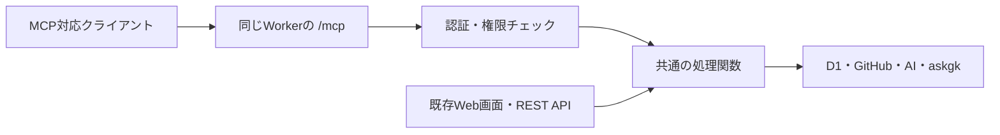

# 提案: 既存WorkerのAPI群をMCPとして公開する

作成日: 2026-10-07
状態: 設計案。実装・依存関係の追加・デプロイは未実施。

## 対象と目的

**対象**: このリポジトリのCloudflare Worker、HonoのREST API、D1のAIチャット履歴・サブクエリ・モデル色、およびGitHub・AI・askgk連携。

既存Workerに `/mcp` を追加し、MCP対応クライアントから履歴検索、会話取得、追加質問の管理、AIへの質問などを呼び出せるようにする。

## 現在の構成

- `wrangler.toml` のエントリーポイントは `src/worker-entry.ts`。
- `src/worker-entry.ts` はHonoアプリの `app.fetch` と定期実行処理を公開している。
- 主なREST APIは `src/index.ts` にあり、確認時点で `/api/` 配下のルート定義は約300件。
- APIキーの発行・ハッシュ照合・有効期限などは `src/utils/apiKeys.ts` に実装されている。キーの接頭辞は `nkapi_`。
- Codexへの質問はaskgkを経由し、回答をモデル名 `codex` としてD1へ保存する。askgkの待機時間は120秒。

## 推奨する構成

同じWorkerで既存REST APIとMCP入口を提供する。まずは状態を持たないMCPハンドラーとし、履歴・会話などの状態は既存D1に保存する。

接続方式はStreamable HTTPを候補とする。Cloudflareの `createMcpHandler` を既存Workerに組み込み、MCP用パスと既存Honoアプリのルーティングを分ける。

既存ルートに直接書かれている処理を必要な範囲から共通関数へ切り出し、RESTとMCPの両方から呼び出す。入力検証、所有権チェック、保存、モデル色、エラー処理を共有する。

MCPハンドラーの導入時は、使用するAgents SDKとMCP SDKの対応バージョン、Workerの互換性設定を公式ドキュメントで再確認する。現状の依存関係にはMCP SDKは含まれていない。

## ツール候補

全APIの一括公開から始めず、用途が明確な10〜20個程度を選ぶ。以下の名前・引数は提案であり、既存APIの確定した仕様ではない。

| ツール名 | 主な入力例 | 役割・既存機能との対応 |
| --- | --- | --- |
| `search_chat_history` | 検索語、検索対象、件数 | `/api/aichat/shares/search` に対応する履歴検索 |
| `get_chat_thread` | スレッドID | `/api/aichat/threads/:threadId` に対応する会話取得 |
| `ask_ai` | 質問、モデル、スレッドID | `/api/aichat` に対応する回答生成・履歴保存 |
| `list_subqueries` | 必要に応じて検索語 | `/api/aichat/subqueries` の登録済み追加質問取得 |
| `create_subquery` | 追加質問の本文 | `/api/aichat/subqueries` の登録 |
| `attach_subquery_link` | 質問、サブクエリID、URL | `/api/aichat/share-subquery-links` の関連付け |
| `search_repository_commits` | リポジトリ、検索語、期間 | リポジトリのコミット検索 |
| `get_model_colors` | なし | `aichat_model_colors` のモデル名・色の対応取得 |

`ask_ai(model="codex", question="…")` は既存askgk経路に接続する。質問本文、回答、モデル名、スレッドID、保存結果を構造化して返す。

例: 「過去のCodex回答からサブクエリに関するものを探し、そのスレッドを読んで」という依頼に対し、クライアント側のAIが `search_chat_history` と `get_chat_thread` を順に呼ぶ。

## 認証と権限

### 自分専用の初期版

Bearerヘッダーを設定できるMCPクライアント向けに、既存の `nkapi_` キーの照合処理を再利用する方式を検討する。これは初期接続方式の案であり、MCPのOAuth認証フローが実装済みという意味ではない。

### 複数ユーザー向け

既存GitHubログインを本人確認に利用し、MCPクライアントへのアクセス許可をOAuthで管理する。GitHubログインだけでMCPクライアントへの権限委譲が完成するわけではなく、MCP用トークン、認証情報の検出・公開、トークンの対象リソース検証などを設計する必要がある。

ツール実行時のユーザーIDは認証結果から取得する。引数で任意のユーザーIDを指定させず、既存の所有権確認を適用する。読み取り・書き込み・管理操作の許可範囲は、MCP用の権限設計として明示する。

## 長時間処理と結果の返し方

Codexなど120秒待つ可能性がある処理は、MCPクライアント側の待機時間も確認する。同期呼び出しで収まらない場合は、次の方式を検討する。

1. 開始ツールが実行IDを返す。
2. Worker側で処理を継続し、状態と結果を保存する。
3. 結果取得ツールが実行IDに対応する状態・回答を返す。

バックグラウンド実行基盤、再試行、重複実行防止、実行IDの所有権チェックは追加設計が必要。MCP化だけで現在の外部呼び出しの時間制限が解消されるわけではない。

各ツールは入力スキーマと構造化した結果を定義する。検索結果には件数・ページングなどの上限を設け、保存失敗を成功扱いにしない。必要に応じて回答やスレッドを参照するMCP Resourcesも後続で検討する。

## 導入順序

1. 履歴検索・スレッド取得・サブクエリ一覧の読み取りツールで `/mcp` の接続と認証を検証する。
2. サブクエリ登録とリンク関連付けを追加し、Web画面と同じ保存・所有権チェックを確認する。
3. Workers AI・Codexへの質問を追加し、履歴保存と長時間処理を検証する。
4. リポジトリ検索など、必要な機能を追加する。

初期版の公開ツールを絞ることで、接続クライアントでのツール発見・呼び出し・エラー表示を確認しやすくする。

## 実装時に確認する事項

- MCP対応クライアントで接続、ツール一覧取得、ツール実行ができること。
- 無効・期限切れの認証情報を拒否し、他ユーザーの履歴やスレッドへアクセスできないこと。
- RESTとMCPで同じ入力に対して保存・検索の結果が一致すること。
- 登録処理の重複実行や再試行で意図しない重複が起きないこと。
- Codexのモデル名・質問本文・モデル色・スレッド情報が既存画面と整合すること。
- 検索件数が増えた場合も、必要な項目をページング等で取得できること。
- 長時間処理と保存失敗の状態をクライアントに返せること。

## 参考資料

- [Cloudflare: MCP handler APIs](https://developers.cloudflare.com/agents/model-context-protocol/apis/handler-api/)
- [Cloudflare: Build a Remote MCP server](https://developers.cloudflare.com/agents/model-context-protocol/guides/remote-mcp-server/)
- [Cloudflare: MCP authorization](https://developers.cloudflare.com/agents/model-context-protocol/protocol/authorization/)
- [MCP: Authorization specification](https://modelcontextprotocol.io/specification/2025-11-25/basic/authorization)
- [MCP: Transport specification](https://modelcontextprotocol.io/specification/2025-11-25/basic/transports)

仕様・SDKは更新されるため、実装開始時点の公開仕様を再確認する。
