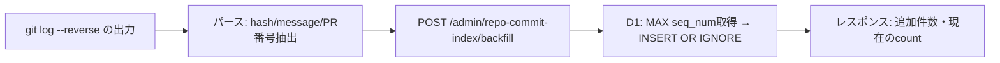

# 提案: 新リポジトリのwebhookオンボーディングを自動化する

作成日: 2026-10-12
状態: 設計案。実装・依存関係の追加・デプロイは未実施。

## 対象と目的

**対象**: [`SPEC.cloudflare-workers-github-oauth-1.new-repo-onboarding.md`](SPEC.cloudflare-workers-github-oauth-1.new-repo-onboarding.md)に記録した、新リポジトリをGitHub webhook通知パイプラインに乗せる8ステップの手動ワークフロー。

現状は人間(またはClaude Codeセッション)が、GitHub側のwebhook設定、D1への確認クエリ発行、既存コミットのバックフィルSQL発行を、都度手で行っている。この手順を部分的・段階的に自動化できないかを整理する。

## 現在の手動ステップのうち、自動化の余地があるもの

| Step | 現状 | 自動化の余地 |
|---|---|---|
| 1. リポジトリ追加・clone | セッションごとに`add_repo`を呼ぶ | 自動化不要(セッション固有の操作) |
| 2. GitHub webhook設定 | 人間がリポジトリのSettingsを手で開いて設定 | GitHub Appの「選択したリポジトリ」に対象を追加するだけなら、GitHub APIで自動化できる可能性がある。リポジトリWebhookの新規作成はGitHub APIの`POST /repos/{owner}/{repo}/hooks`で可能 |
| 3. 動作確認コミットのpush | 人間が明示的に指示して行う | 自動化しない方がよい(対象リポジトリへの書き込みは常に明示的な承認を要する) |
| 4. Recent deliveries確認 | 人間がブラウザで確認 | GitHub APIの`GET /repos/{owner}/{repo}/hooks/{id}/deliveries`で取得可能。CLIやスクリプト化できる |
| 5. `webhook_log`確認 | D1コンソールに人間がSQLを貼る | 本体Worker側に診断用の内部APIを用意すれば自動化できる(下記「段階的な自動化案」参照) |
| 6. `repo_commit_index`確認 | 同上 | 同上 |
| 7. 既存コミットのバックフィル | `SPEC...COMMITDB.md`の手順で人間が都度SQLを生成・実行 | **最も自動化価値が高い。** 下記参照 |
| 8. `/wspace`表示確認 | 人間が目視でページを開く | スクリーンショット取得程度は自動化できるが、「意味のある場所に表示されているか」の最終判断は人間に残すべき(NOTICEの5節の教訓: 200が返ることと実際に表示されることは別) |

## 段階的な自動化案

### 案1: Step 7(バックフィル)専用の内部管理エンドポイントを追加する

最も繰り返し作業になりやすいのはStep 7。新リポジトリを追加するたびに、`git log`の出力を人間(またはLLM)が目視でパースし、`INSERT OR IGNORE`文を手で組み立てている。

`POST /admin/repo-commit-index/backfill`のような内部エンドポイントを本体Workerに追加し、リクエストボディで`{ repoName, commits: [{ hash, message, prNumber }] }`を受け取り、`SELECT MAX(seq_num)`から`INSERT OR IGNORE`までを1回のAPI呼び出しで行う案。

利点: SQLをコピー&ペーストする手順(現状の「コピー用SQLは自動アップロード禁止、チャットで渡す」という運用、CLAUDE.mdルール33参照)自体が不要になり、人間のコピペミスや二重実行の余地が減る。

注意点: 新しい管理エンドポイントは認証が必要(CLAUDE.mdルール37「ユーザーが承認していない環境変数・設定スイッチを勝手に追加するな」と同様、新規エンドポイントも実装前にユーザー確認が必要)。また、このエンドポイント自体もCLAUDE.mdルール9(テストファースト)に従い、失敗するテストを先に書いてから実装すべき。

### 案2: Step 4〜6(確認)を1本のヘルスチェックスクリプトにまとめる

GitHub APIでのdeliveries取得、D1の`webhook_log`・`repo_commit_index`クエリの3つを、1回のコマンドで順に実行し、「新リポジトリ`<owner>/<repo>`のオンボーディング状態: OK/NG」という形式で返すスクリプト(Node.jsまたはシェル)を作る案。

ローカル実行(Claude Codeセッション内、またはユーザーのローカル環境)を前提とし、Cloudflare Workerへの新規エンドポイント追加は不要。GitHub APIを呼ぶには`gh` CLIまたはPAT(`ghp_*`)が必要だが、`CLAUDE.md`記載の制約により、このセッションからは認証済みの`gh`が使えない(GitHub APIトークンが存在しない)。したがって、この案は**ユーザーのローカル環境での実行を前提とする**必要がある。

### 案3: GitHub App Webhookのinstallation_repositoriesイベントを使い、Step 2の一部を無くす

GitHub Appを「All repositories」で運用する場合、新リポジトリの追加がそもそも不要になる(自動的に対象になる)。現状「選択したリポジトリ」運用をしている場合、リポジトリが増えるたびにインストール対象への追加作業(Step 2の一部)が発生する。

「All repositories」への切り替えは、CLAUDE.mdルール37の「ユーザーが承認していない設定スイッチを勝手に追加するな」に相当する判断(権限範囲の変更)であるため、自動化ではなくユーザーへの提案として留める。組織内の全リポジトリを無差別に対象にすることのセキュリティ上の影響(意図しないリポジトリのコミット内容がAI要約に渡る等)を検討した上で、ユーザーが判断すべき。

## 自動化しない方がよいと考える部分

- **Step 3(動作確認コミットのpush)**: 対象リポジトリへの書き込みは、誤ったリポジトリに自動でコミットが入るリスクがあるため、常に人間の明示的な指示を経るべき。
- **Step 8の最終判断**: NOTICEの5節(write-onlyなデータストア事故)の教訓通り、「データが実際に意味のある形で表示されているか」を機械的なチェックだけで保証するのは難しい。ページの見た目が変わる(UI変更)たびにチェックロジックも追従させる必要があり、保守コストが見た目の確認の手間を上回る可能性がある。

## まとめ: 優先順位

1. **案1(バックフィルAPI)** — 繰り返し発生する作業かつ、既存のSQL手動運用(`CLAUDE.md`ルール24)をそもそも廃止する方向性(push時の自動追記、2026-10-04導入)と地続きなので、最も投資効果が高い。
2. **案2(ヘルスチェックスクリプト)** — ローカル実行前提になるため、このセッションの外での運用が必要。優先度は中。
3. **案3(All repositories化)** — 自動化というより運用方針の変更であり、ユーザー判断が必要。提案のみ。

いずれも実装前に、該当するCLAUDE.mdルール(9: テストファースト、33: 自動アップロード対象の区別、37: 無断の設定追加禁止)に従い、ユーザーへの事前確認を行うこと。
